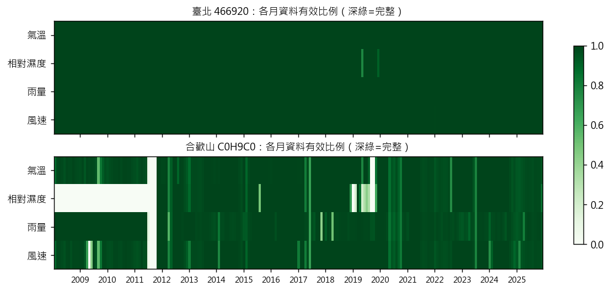

# 第 4 週產出：資料清理（缺值處理、時間戳記對齊、篩選夜間時段）

計畫書第 4 週檢核目標：產出乾淨的夜間資料表。
程式：src/hehuan/clean.py（清理）、scripts/build_hourly.py（逐時表）、scripts/build_nights.py（夜間表）。

## 一、缺值處理

氣象署的缺值不是空白，而是寫成看起來像數字的「代碼」。如果不處理，平均濕度會被 -9997 拉成負數。

| 代碼 | 出現在 | 臺北次數 | 合歡山次數 | 處理 |
|---|---|---|---|---|
| -9997 | 濕度 | 0 | 31,538 | 視為缺值 |
| -9999.7 | 氣壓 | 0 | 31,224 | 視為缺值 |
| -9995 / -9991 | 濕度 | 236 | 5,934 | 視為缺值 |
| -999.6 / -999.5 / -999.1 | 雨量 | 1 | 4,605 | 視為缺值 |
| -99.5 / -99.7 / -99.1 | 氣溫、風速、露點 | 246 | 9,349 | 視為缺值 |
| -99.95 | 紫外線 | 593 | — | 視為缺值 |
| **-99.7** | **人工雲量** | — | — | **不是缺值：代表「起霧看不到天空」，改記為雲量 10** |

規則：所有數值 ≤ -90 一律當缺值，但清理前先把每一種代碼數過一遍存成表（data/processed/qc/sentinel_codes.csv），確保沒有東西被默默丟掉。人工雲量的 -99.7 是例外，判讀依據是它出現時能見度 100% 都小於 1 公里（見 results/truth_audit.md）。

另外兩個缺值相關的規則：
- **近 3 小時雨量**：三小時中任一小時缺值，總和就記為「未知」，不可以當成「沒下雨」，否則會把正在下雨的時段判成晴。
- **合歡山濕度 2011 年 11 月以前全缺**（三年多都是 -9997），所以合歡山實際可用期間是 2011-12 到 2025-12，這段期間濕度有效率 93%。

## 二、時間戳記對齊

1. **24 點的寫法**：氣象署每天第 24 筆寫成「23:59」，實際上是 24:00 的觀測。轉成隔天 00:00，否則每晚會少一小時、多出一個重複時間。
2. **時區**：全部用臺灣標準時間（UTC+8）。ERA5 從 Open-Meteo 抓的時候直接指定臺北時區，兩邊可以直接對齊。
3. **小時終標籤**：「21:00」代表 20:01–21:00 這一小時的累積雨量，或 21:00 那一刻的溫濕度。
4. **補齊時間軸**：把每站資料填成連續的每小時一列，缺的小時留空，方便之後算連續時數。
5. **驗證時間沒有錯位**：用日射量檢查。每天第一個有日射的小時應該在日出後一小時內。臺北站逐月檢查的中位數偏移是 0 到 1 小時，表示時間戳沒有錯位一小時（合歡山站沒有日射欄位，無法用這招，改用與相鄰昆陽站逐時比對，兩站濕度中位差 2%）。

## 三、衍生變數

- **露點差** = 氣溫 − 露點。露點由氣溫和濕度用 Magnus 公式算（氣溫低於 0 °C 時改用冰面公式），讓有人站和合歡山用同一個定義。在臺北站和氣象署自己量的露點比對，平均誤差 0.05 °C，公式可信。
- **近 3 小時、近 6 小時雨量**（含「是否已知」欄位）。

## 四、感測器檢查

- **濕度上限**：合歡山每年有 33–56% 的小時濕度 ≥ 98%（測站在雲裡）；臺北幾乎為 0。這是兩地最大的氣候差異，也是為什麼濕度在高山能判斷雲況。
- **疑似卡住**：濕度連續 12 小時以上停在同一個值、而且不是飽和值，標記為疑似故障。
  - 9 月第一版把每年最高值（100%）當成唯一的飽和值，結果合歡山有 5,182 小時被誤標，其中八成停在 99%——那其實是測站在雲裡。修正為「97% 以上都算飽和」後，合歡山剩 185 小時、臺北 12 小時。這個標記只用於品質報告，沒有進入任何機率計算，所以已發表的結果不受影響。
- **結冰跡象**：合歡山冬夜偶有整晚風速 0.0、濕度 98–99%、氣溫 −4 °C 的情況，很可能是風速計結冰。風速不在主要規則裡，記為已知限制。

## 五、篩選夜間時段，產出夜間資料表

夜間 = 前一天 20:00 到當天 04:00 的 9 個整點，歸屬於「傍晚那天」的日期（例如 12/14 晚上到 12/15 清晨都算 12/14 那一晚）。

| | 臺北 466920 | 合歡山 C0H9C0 |
|---|---|---|
| 逐時表（2008–2025） | 157,799 小時 | 157,055 小時 |
| 夜間小時 | 59,174 | 58,895 |
| 夜數 | 6,576 | 6,545 |
| 夜間濕度有效率 | 99.8% | 73.8%（2011-12 起 93%） |
| 近 3 小時雨量已知率 | 100% | 93.4% |

夜間表每一列有：測站的氣溫、濕度、露點差、雨量、風速，加上 ERA5 同一小時的總雲量、低中高雲量。檔案：data/processed/night_hours/&lt;站號&gt;_night_hours.csv.gz。

### 範例：合歡山 2024-12-14 那一晚

| 時間 | 氣溫 | 濕度 | 露點差 | 近 3 小時雨量 | 風速 | ERA5 總雲量 | ERA5 中高雲 |
|---|---|---|---|---|---|---|---|
| 20:00 | −1.9 | 99% | 0.1 | 未知 | 0.0 | 0.96 | 0.10 |
| 22:00 | −2.6 | 99% | 0.1 | 0 | 0.0 | 0.75 | 0.08 |
| 00:00 | −3.5 | 98% | 0.2 | 0 | 0.0 | 0.28 | 0.09 |
| 01:00 | 缺 | 缺 | 缺 | 0 | 缺 | 0.19 | 0.07 |
| 04:00 | −4.7 | 98% | 0.2 | 0 | 0.0 | 0.17 | 0.09 |

這一晚示範了幾件事：測站整晚在雲霧裡（露點差 < 0.5 °C，規則判「不可觀星」）；ERA5 的低雲在午夜後散去，但 25 公里的格點平均看不到測站本身的霧；01:00 有一小時缺值；風速整晚 0.0 疑似結冰。

## 自我檢核
- [x] 產出乾淨的夜間資料表
- [ ] 修正：合歡山實際可用期間為 2011-12 起；「疑似卡住」規則修正飽和範圍（不影響結果）
