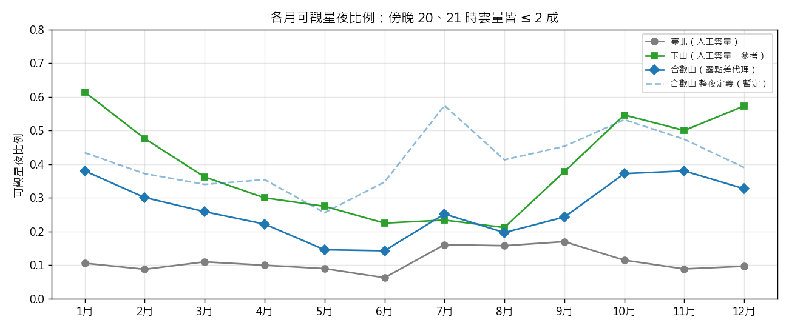

# 第 5 週產出：「可觀星夜」的操作型定義、兩站歷史資料標記

計畫書第 5 週檢核目標：完成標記，統計兩地可觀星夜的比例與季節分布。
程式：scripts/label_nights.py。標籤檔：data/processed/labels/&lt;站號&gt;_night_labels.csv。

## 一、操作型定義

「操作型定義」是指把「可以觀星」這個模糊的說法，換成一條任何人拿到資料都能照著判斷、結果一樣的規則。

### 1. 一個小時算「晴」

**總雲量 ≤ 2 成**（0–10 制）。起霧看不到天空的時候算雲量 10。

理由：天文台文獻的「可做精密測光的夜晚」要求雲量低於 1/8（約 1.25 成）；我們放寬到 2 成，因為社團是目視與攝影，不是測光。也試過 1 成、3 成，月份排序幾乎不變（見第 11 週敏感度分析）。

### 2. 一個晚上算「可觀星」

| 名稱 | 規則 | 地位 | 理由 |
|---|---|---|---|
| **傍晚可觀星**（主定義） | 20:00 與 21:00 兩個小時都晴 | 已驗證 | 氣象署觀測員每天只在這兩個時間記錄夜間雲量，這是唯一有人親眼確認過的時段；也是社團活動最主要的時段 |
| 整夜可觀星（副定義） | 20:00–04:00 中至少連續 3 小時晴，且至少 6 小時有資料 | 暫定 | 天文台常用「連續數小時晴」當可用夜；但合歡山沒有雲量，整夜只能靠代理指標推估，後半夜的驗證證據還不夠 |

### 3. 沒有雲量觀測的合歡山怎麼辦

合歡山測站沒有雲量欄位，所以用**露點差代理指標**判斷每個小時晴不晴：

> 露點差 ≥ 2.2 °C 且近 3 小時沒下雨 → 晴

這條規則是在玉山站（3,845 m）用 2008–2021 年約一萬筆人工夜間雲量驗證過的（一致性 kappa 0.60，詳見 results/validation_467550.md），再用海拔梯度與周邊測站一致性證明可以套用到合歡山。臺北不用代理指標，因為臺北有人工雲量，而且規則在平地不準。

## 二、本週新增的證據：衛星雲量改版後可以看後半夜了嗎？

10/8 小觀時發現，氣象署 2025 年 6 月改版後的衛星雲量和肉眼很接近。本週檢查了這件事：

| 檢查 | 改版前 | 改版後 |
|---|---|---|
| 玉山白天，衛星 vs 人工雲量的一致性（kappa） | 0.45 | 0.54 |
| 玉山夜間，衛星報「晴」的小時比例 | 0% | 34% |
| 衛星報晴時的平均濕度 / 報陰時的平均濕度 | — | 61% / 86% |

改版後的衛星雲量變得合理，但只有 15 個月、一致性中等，所以**不當主要真值，只當輔助**。用它第一次檢查露點差規則在整夜各小時的表現（玉山，2025-06 起）：

| 季節 | 前半夜 20–23 時 kappa | 後半夜 00–04 時 kappa |
|---|---|---|
| 冬半年 10–3 月 | 0.43 | 0.46 |
| 夏半年 6–9 月 | 0.25 | 0.27 |

結論：**冬半年規則在後半夜和前半夜一樣可靠**，所以整夜定義在觀星季有一定依據；夏季前後半夜都偏樂觀（規則判晴 50% 以上，衛星只有 20% 左右），所以夏季整夜數字要打折。這兩個 kappa 比 0.60 低，部分原因是衛星本身也不完美。細表：results/tables/sat2025_vs_rule_by_hour_467550.csv。

## 三、標記結果

| 地點 | 標記來源 | 期間 | 標記夜數 | 可觀星夜 | 比例 |
|---|---|---|---|---|---|
| 臺北 466920 | 人工雲量 | 2008–2017 | 3,378 | 379 | **11.2%** |
| 合歡山 C0H9C0（傍晚） | 露點差代理 | 2011–2025 | 4,485 | 1,211 | **27.0%** |
| 合歡山 C0H9C0（整夜，暫定） | 露點差代理 | 2011–2025 | 4,675 | 1,926 | 41.2% |
| 玉山 467550（參考） | 人工雲量 | 2008–2021 | 5,089 | 1,993 | 39.2% |

臺北的夜間人工觀測到 2017 年為止。合歡山的濕度從 2011 年 12 月才有資料。

### 季節分布（傍晚定義）

| 地點 | 冬（12–2 月） | 春（3–5 月） | 夏（6–8 月） | 秋（9–11 月） |
|---|---|---|---|---|
| 臺北 | 9.7% | 10.0% | 12.8% | 12.5% |
| 合歡山 | **33.6%** | 21.0% | 19.8% | **33.3%** |
| 玉山（參考） | 55.7% | 31.3% | 22.4% | 47.6% |

### 各月（傍晚定義）

| 月 | 1 | 2 | 3 | 4 | 5 | 6 | 7 | 8 | 9 | 10 | 11 | 12 |
|---|---|---|---|---|---|---|---|---|---|---|---|---|
| 臺北 | .11 | .09 | .11 | .10 | .09 | .06 | .16 | .16 | .17 | .12 | .09 | .10 |
| 合歡山 | .38 | .30 | .26 | .22 | .15 | .14 | .25 | .20 | .24 | .37 | .38 | .33 |
| 玉山 | .61 | .48 | .36 | .30 | .28 | .22 | .23 | .21 | .38 | .55 | .50 | .57 |

## 四、觀察

1. **合歡山的可觀星機率大約是臺北的 2.5 倍**（27% 對 11%）。
2. **兩地的季節型態相反。** 合歡山秋冬最好、5–6 月梅雨最差；臺北反而是 7–9 月稍好、冬天最差。原因是冬天的東北季風在臺北盆地造成低雲，但這層雲通常在 1,500–2,000 公尺以下，合歡山在雲層上方。
3. **合歡山比玉山差。** 合歡山測站約一半的時間濕度 ≥ 98%（在雲裡），玉山只有兩三成。合歡山位於中央山脈東西兩側氣流交會處，更容易起霧。
4. **臺北 10/8 那晚屬於少見的好天氣**：臺北 10 月只有 12% 的傍晚可觀星。

## 自我檢核
- [x] 完成標記
- [x] 統計兩地可觀星夜的比例與季節分布
- [ ] 修正：原計畫以「雲量、濕度、風速、能見度」共同定義；改為以雲量定義，濕度（露點差）只用於合歡山的代理判斷，避免用同一組變數定義又分析的循環論證。風速與能見度不納入定義。
