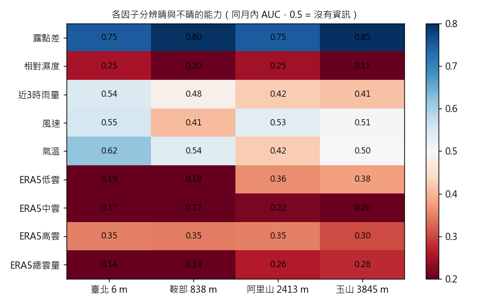
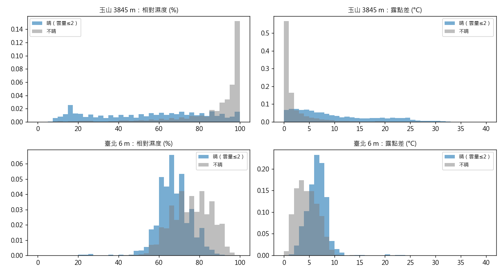
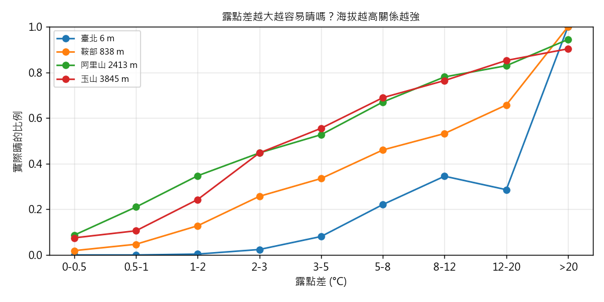
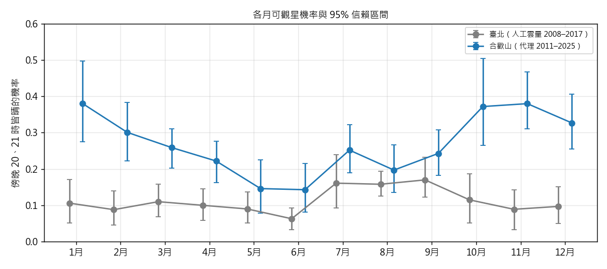

# 第 6 週產出：氣象因子與可觀星夜的關係、兩地各月可觀星機率

計畫書第 6 週檢核目標：完成至少三張分布圖與月份機率表。
程式：scripts/factor_analysis.py。表格：results/tables/week06_*.csv。

## 一、方法

- **因子分析只用有人工雲量的四個站**（臺北、鞍部、阿里山、玉山，20、21 時）。合歡山沒有雲量，它的「晴」是由露點差算出來的，拿露點差去分析它會循環論證。
- **指標用 AUC**：隨機挑一個晴的小時和一個不晴的小時，因子值在晴的那邊較高的機率。0.5 是沒有資訊，離 0.5 越遠越有用；低於 0.5 表示因子越大越不容易晴。
- **同月內 AUC**：每個月分開算再平均，排除「夏天又熱又多雲」這種季節造成的假關係。

## 二、哪些因子有用

| 因子 | 臺北 6 m | 鞍部 838 m | 阿里山 2413 m | 玉山 3845 m |
|---|---|---|---|---|
| 露點差 | 0.75 | 0.80 | 0.75 | **0.85** |
| 相對濕度 | 0.25 | 0.20 | 0.25 | 0.15 |
| ERA5 總雲量 | **0.14** | **0.14** | 0.26 | 0.28 |
| ERA5 中雲 | 0.17 | 0.17 | **0.22** | 0.20 |
| ERA5 低雲 | 0.19 | 0.18 | 0.36 | 0.38 |
| ERA5 高雲 | 0.35 | 0.35 | 0.35 | 0.30 |
| 近 3 時雨量 | 0.54 | 0.48 | 0.42 | 0.41 |
| 風速 | 0.55 | 0.41 | 0.53 | 0.51 |
| 氣溫 | 0.62 | 0.54 | 0.42 | 0.50 |

讀法與發現：

1. **露點差與濕度在四站都有明顯資訊**，兩者方向相反、強度相同，所以只需要留一個。
2. **低海拔 ERA5 較好，玉山則是露點差最好。** 玉山 ERA5 低雲的資訊很弱（0.38），可能因為 ERA5 算的是 25 公里格點，低雲常在測站下方；這是解釋，本週資料沒有直接證明。
3. **風速和氣溫對判斷晴不晴幾乎沒有資訊。** 玉山同月內分別是 0.51、0.50。氣溫全年算是 0.41、同月內變 0.50，正好示範季節造成的假關係。風速仍和安全與舒適有關，但不該放進雲況判斷。
4. **雨量資訊有限**（0.41–0.54）：多數小時本來就沒下雨。它的作用是排除正在下雨的時段，不是分辨晴與多雲。

### 分布圖

玉山的晴與不晴分得較開；臺北兩者大幅重疊。

### 露點差對應的實際晴天比例

| 露點差 °C | 0–0.5 | 0.5–1 | 1–2 | 2–3 | 3–5 | 5–8 | 8–12 | 12–20 |
|---|---|---|---|---|---|---|---|---|
| 臺北 | 0% | 0% | 0% | 2% | 8% | 22% | 35% | 29% |
| 鞍部 | 2% | 5% | 13% | 26% | 34% | 46% | 53% | 66% |
| 阿里山 | 9% | 21% | 35% | 45% | 53% | 67% | 78% | 83% |
| 玉山 | 8% | 11% | 24% | 45% | 56% | 69% | 76% | 85% |

同樣的露點差，在不同海拔代表的晴天機率差很多：露點差 5–8 °C，玉山 69%、臺北只有 22%。臺北即使露點差很大也多半不晴，這和 10/8 那晚看到的現象一致。所以**門檻不能跨海拔直接搬**：把玉山的 2.2 °C 用在臺北，會判 70% 的小時為晴，實際只有 14%。

## 三、各月可觀星機率（傍晚 20、21 時皆晴）

| 月 | 1 | 2 | 3 | 4 | 5 | 6 | 7 | 8 | 9 | 10 | 11 | 12 |
|---|---|---|---|---|---|---|---|---|---|---|---|---|
| 臺北（人工雲量 2008–2017） | .11 | .09 | .11 | .10 | .09 | .06 | .16 | .16 | .17 | .12 | .09 | .10 |
| 95% 區間 | .05–.17 | .05–.14 | .07–.16 | .06–.15 | .05–.14 | .03–.09 | .09–.24 | .12–.19 | .12–.23 | .05–.19 | .03–.14 | .05–.15 |
| 合歡山（代理 2011–2025，暫定） | .38 | .30 | .26 | .22 | .15 | .14 | .25 | .20 | .24 | .37 | .38 | .33 |
| 95% 區間 | .28–.50 | .22–.38 | .20–.31 | .16–.28 | .08–.22 | .08–.22 | .19–.32 | .14–.27 | .18–.31 | .26–.50 | .31–.47 | .26–.41 |

- **合歡山 10 月到 1 月最好，5、6 月最差**；11 月與 5、6 月的區間完全不重疊，這個季節差異站得住。10、11、12、1 月彼此無法分出高下，不要解讀成「11 月比 12 月好」。
- **10 月到 4 月合歡山高於臺北**，區間不重疊；5 到 9 月有重疊。共同期 2012–2017 全年是 26% 對 13%。兩邊判定方法不同，這個比較只能當參考。
- **夏季的合歡山數字可能偏高。** 規則在玉山 6–8 月高估 0.11–0.15，冬季幾乎沒有偏差。這裡沒有校正，因為玉山的偏差不能直接假設適用合歡山。

## 四、雲量門檻敏感度

改變「晴」的定義後，重新選露點差門檻並套用到合歡山：

| 晴 = 雲量 ≤ | 露點差門檻 | 玉山 kappa | 合歡山全年 | 月份排序相關（對 ≤2） |
|---|---|---|---|---|
| 1 成 | 2.73 °C | 0.55 | 24.9% | 1.00 |
| **2 成** | 2.21 °C | 0.60 | 27.0% | — |
| 3 成 | 2.03 °C | 0.64 | 27.4% | 0.99 |

月份排序不受影響。合歡山全年比例變化不大，是因為那裡的濕度分布兩極：不是在雲裡就是很乾。

## 五、規則能不能搬到合歡山：本週的重新評估

9 月的論證是「kappa 隨海拔上升，所以合歡山可用」。本週發現這個論證比我當時寫的弱：

- kappa 受晴天比例影響。同月內 AUC 是 0.75、0.80、0.75、0.85，**不是單調上升**，只有玉山明顯較高。
- 先前推估的「合歡山 kappa 0.45–0.55」沒有直接依據，已撤回。

目前支持與不足的證據：

| 證據 | 結果 | 強度 |
|---|---|---|
| 規則判定 vs ERA5 中雲（與測站濕度無關），同月內 AUC | 合歡山 0.23、昆陽 0.22、玉山 0.22 | 中：一致，但鞍部 0.28、大禹嶺 0.27 也相近，分辨力有限 |
| 鄰站同小時一致性 | 昆陽、小奇萊 kappa > 0.7 | 中：證明不是單站雜訊，不證明判得對 |
| 合歡山現場雲量對照 | 尚無 | 12/11–13 大觀是第一筆 |
| 鹿林天文台雲感測器 | 已下載，未解析 | 2862 m 的獨立儀器真值，但也不在合歡山 |

結論：合歡山的數字維持**暫定**。季節形狀可以相信，絕對機率要保守看待。

## 自我檢核
- [x] 完成至少三張分布圖（本週四張）
- [x] 完成月份機率表
- [ ] 修正：風速、氣溫經分析對雲況幾乎沒有資訊，不納入判斷；合歡山結果由「已驗證」改標「暫定」
