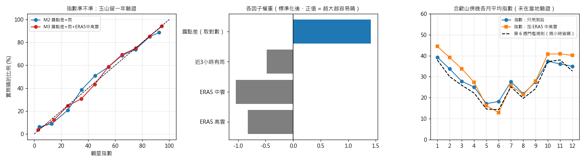

# 第 7 週產出：以歷史資料決定權重、建立觀星指數並驗證

計畫書第 7 週檢核目標：完成指數公式；完成分析階段報告初稿（見 docs/phase1_分析階段報告初稿.md）。
程式：scripts/build_index.py。公式存檔：results/tables/index_formula.json。

## 一、指數是什麼

**觀星指數 = 估計「這個小時雲量 ≤ 2 成」的機率，0 到 100。**

權重不是自己訂的，而是用玉山站 2008–2021 年 20、21 時共 10,185 筆人工雲量，以邏輯迴歸算出來的。邏輯迴歸會找出一組權重，讓算出的機率和實際晴或不晴最吻合。

## 二、公式

先算 z，再換成 0–100：指數 = 100 ÷ (1 + e^(−z))

| 版本 | z 的算法 | 需要的資料 |
|---|---|---|
| **只用測站** | z = −2.16 + 1.46 × ln(1 + 露點差) − 2.21 × 有雨 | 氣溫、濕度、雨量 |
| **加 ERA5** | z = −0.93 + 1.34 × ln(1 + 露點差) − 1.29 × 有雨 − 3.61 × 中雲 − 1.97 × 高雲 | 另加 ERA5 中雲、高雲（0–1） |

「有雨」= 近 3 小時有降雨記 1，否則 0。露點差單位 °C。

例：露點差 8 °C、無雨、中雲 0.1、高雲 0 → z = −0.93 + 1.34×2.20 − 0.36 = 1.65 → 指數 84。
例：露點差 0.5 °C（在霧裡）、無雨、中雲 0.5、高雲 0.3 → z = −2.78 → 指數 6。

## 三、各因子的權重

把每個因子換成同一尺度後比較（加 ERA5 版）：

| 因子 | 標準化權重 | 占比 | 方向 |
|---|---|---|---|
| 露點差 | +1.41 | 38% | 越大越容易晴 |
| ERA5 中雲 | −1.04 | 28% | 越多越不晴 |
| ERA5 高雲 | −0.82 | 22% | 越多越不晴 |
| 近 3 小時有雨 | −0.48 | 13% | 有雨不晴 |

風速、氣溫沒有放進去，因為第 6 週算出它們對雲況沒有資訊。ERA5 低雲也沒放：加進去後成績完全沒有變好（見下表 M3 與 M4）。

## 四、驗證（玉山，留一年）

每一年都用「沒看過那一年」的模型去預測，再和實際比。

| 模型 | AUC | Brier（越低越好） | 比月氣候好多少（BSS） | 各年 AUC 範圍 |
|---|---|---|---|---|
| M1 露點差 | 0.860 | 0.147 | 36% | 0.78–0.90 |
| M2 露點差＋雨 | 0.872 | 0.142 | 38% | 0.81–0.90 |
| **M3 露點差＋雨＋ERA5 中高雲** | **0.910** | **0.118** | **48%** | 0.86–0.94 |
| M4 再加 ERA5 低雲 | 0.910 | 0.118 | 48% | 0.86–0.94 |
| M5 只用 ERA5 | 0.840 | 0.162 | 29% | 0.80–0.88 |

- 測站資料和 ERA5 各自都有用，合起來最好：地面濕度看得到測站附近的雲霧，ERA5 補上看不到的中高雲。
- **指數說多少就是多少。** 指數 80–90 的小時實際 85% 晴；指數 10–20 的小時實際 12% 晴（加 ERA5 版，完整表在 results/tables/week07_reliability.csv）。
- 以「晚」為單位（20、21 時指數平均 vs 兩小時皆晴）：5,089 晚，AUC 0.91。

說明：選 M3 是比較五個模型的留一年成績後決定的，所以 M3 的數字略偏樂觀；M3 與 M2 的差距遠大於這個效應。

## 五、權重能不能搬到別的地方

把玉山的公式原封不動用在其他有人站：

| 測站 | AUC（玉山權重） | AUC（該站自己的權重） | 平均指數 | 實際晴 % |
|---|---|---|---|---|
| 臺北 6 m | 0.84 | 0.86 | 46 | 14 |
| 鞍部 838 m | 0.87 | 0.88 | 26 | 13 |
| 阿里山 2413 m | 0.84 | 0.85 | 30 | 31 |
| 玉山 3845 m | 0.91 | 0.91 | 42 | 42 |

（加 ERA5 版。只用測站版：AUC 0.76、0.81、0.79、0.87。）

兩個結論：

1. **排序能力可以搬。** 用玉山權重和用當地自己的權重，AUC 幾乎一樣。也就是「哪個晚上比較好」的判斷到別處仍然有效。
2. **絕對數值不能搬。** 同一條公式在臺北平均給 46 分，實際只有 14% 晴；在阿里山則幾乎剛好（30 對 31）。指數的高低在不同地點代表的機率不同。

對合歡山的意義：指數可以用來**比較月份和日期的好壞**；「合歡山 11 月有 40% 機率」這種絕對數字則不保證準，而且沒辦法知道偏高還是偏低。四個站裡海拔最接近的阿里山偏差最小，但這不能當作合歡山也準的證據。

## 六、套用到合歡山（未在當地驗證）

傍晚 20、21 時各月平均指數：

| 月 | 1 | 2 | 3 | 4 | 5 | 6 | 7 | 8 | 9 | 10 | 11 | 12 |
|---|---|---|---|---|---|---|---|---|---|---|---|---|
| 只用測站 | 39 | 34 | 28 | 25 | 17 | 18 | 28 | 22 | 28 | 37 | 36 | 35 |
| 加 ERA5 | 45 | 39 | 34 | 27 | 16 | 13 | 26 | 22 | 28 | 41 | 41 | 40 |
| 第 6 週門檻規則 | 38 | 30 | 26 | 22 | 15 | 14 | 25 | 20 | 24 | 37 | 38 | 33 |

三種算法的月份排序幾乎相同（相關 0.98）：10 月到 1 月最好，5、6 月最差。門檻規則那一列是「兩小時都晴」的比例，和平均指數不是同一種量，數值不能直接相減。

## 七、和原計畫的差異

原計畫想做的是「各項條件加權的分數」，權重靠資料決定。實際做法是讓邏輯迴歸直接算出權重，而且指數本身就是機率，可以用實際觀測檢查準不準。原本列的風速、能見度沒有進入公式。

## 自我檢核
- [x] 完成指數公式
- [x] 完成分析階段報告初稿
- [ ] 修正：指數改為以邏輯迴歸估計的晴天機率；因子為露點差、降雨、ERA5 中高雲；驗證顯示排序可跨站使用，絕對數值不可
