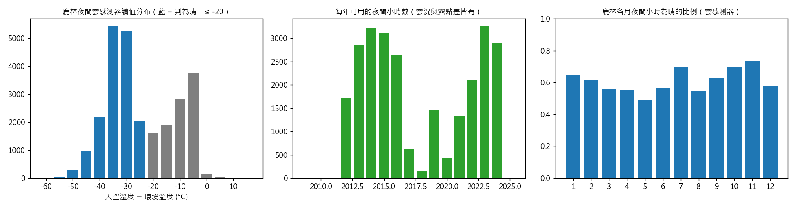

# 第 9 週產出：鹿林天文台雲感測器與氣象站紀錄解析

計畫書第 9 週檢核目標：完成鹿林天文台逐時資料表。
程式：src/hehuan/lulin.py、scripts/build_lulin.py。

## 一、為什麼用鹿林

合歡山沒有任何雲量觀測，玉山的人工雲量又只有 20、21 時。中央大學鹿林天文台（海拔 2,862 m，距玉山測站約 8 公里）有一台**雲感測器**，每 10 分鐘自動量一次，整夜都有。它是台灣高山上唯一公開、能檢查「後半夜」的獨立雲況紀錄。原始檔由天文台網站公開下載（原始檔約 1.2 GB，不放進 repo）。

## 二、原始資料

| 來源 | 內容 | 期間 | 頻率 |
|---|---|---|---|
| 雲感測器（Boltwood Cloud Sensor II） | 天空溫度減環境溫度、環境溫度、是否潮濕 | 2012-06 至 2024-12（中間有缺） | 約 10 分鐘 |
| 氣象站（Davis） | 氣溫、濕度、露點、風速、雨量 | 2009 至 2025 | 每分鐘 |

**雲感測器怎麼看雲**：它用紅外線量天空的溫度。晴朗的夜空很冷，比地面氣溫低 30 度左右；有雲的時候雲底溫度接近氣溫，差距只有幾度。

## 三、怎麼整理成逐時資料

1. **時間**：氣象站 2018 年前用 12 小時制（`12:01 a`），之後用 24 小時制，統一轉換。全部是臺灣時間，採「小時終」標籤，和氣象署資料一致。
2. **氣象站**：整點的氣溫、濕度取前 10 分鐘平均；雨量取該小時合計（少於 45 分鐘資料則記為缺值）。露點差用和其他測站相同的 Magnus 公式計算；和氣象站自己算的露點平均只差 0.03 °C。
3. **雲感測器**：取整點前後 25 分鐘內的讀值（通常 5 筆）的中位數，至少要 3 筆。
4. **晴的判定**：中位數 ≤ −20 °C，而且這段時間感測器沒有偵測到潮濕。

### 門檻 −20 °C 怎麼來的

夜間讀值的分布有兩個峰：晴的一群集中在 −25 到 −40，陰的一群集中在 −10 到 0，中間 −20 到 −15 最少（見圖左）。門檻訂在兩峰之間的谷底，而且是**只看雲感測器自己的分布決定的，沒有參考濕度或露點**，所以下週拿它檢驗露點差規則時不會循環論證。

| 門檻 | 夜間判為晴的比例 |
|---|---|
| −15 °C | 66.6% |
| **−20 °C** | **61.2%** |
| −25 °C | 53.8% |

門檻選擇會讓晴的比例差 13 個百分點，下週的比對要三個門檻都做。

## 四、產出

| 檔案 | 內容 |
|---|---|
| data/processed/lulin/lulin_hourly.csv.gz | 2009–2025 每小時：氣溫、濕度、露點差、雨量、雲感測器讀值與晴／不晴 |
| data/processed/lulin/lulin_night_hours.csv.gz | 20–04 時、雲況與露點差都有的小時：**25,771 小時、2,911 晚** |
| results/tables/week09_lulin_coverage.csv | 各年可用時數與檢查結果 |

各年可用的夜間小時數：2013–2016 與 2022–2024 每年 2,100–3,260 小時；2017、2018、2020 很少（630、159、430 小時，只涵蓋幾個月）。各月份的樣本數平均（每月 1,800–2,570 小時）。

## 五、品質檢查

| 檢查 | 結果 |
|---|---|
| 兩台儀器的時鐘是否一致（雲感測器的環境溫度 vs 氣象站氣溫） | 各年相關 0.82–0.95，最佳時間差為 0 小時；只有 2017 年顯示可能差 1 小時（該年只有 1,662 小時） |
| 雲感測器「潮濕」與氣象站雨量是否一致 | 潮濕時 72% 有雨量；有雨量時 73% 顯示潮濕 |
| 露點計算 | 與氣象站內建露點平均差 0.03 °C |
| 異常值 | 天空溫差超出 −80 到 40、氣溫超出 −30 到 40 的列剔除 |

## 六、已知問題

1. **各年「晴」的峰位置不同**：多數年份在 −30 上下，2018–2020 與 2024 在 −40 上下，可能是感測器更換或設定改變。兩種情況谷底都在 −20 附近，所以用同一個門檻，但屬於不確定來源。
2. **紅外線雲感測器看不清楚又高又薄的卷雲**（卷雲本身很冷，看起來像晴空），所以它判的「晴」可能偏多。
3. 氣象站的氣壓欄各年單位不同（543、758、1010、727），本研究沒用氣壓。
4. 2017 年可能有 1 小時時差，下週比對時單獨檢查。
5. 鹿林不是合歡山，兩地相距約 85 公里。

## 七、解析時看到的現象（下週正式檢驗）

雲感測器顯示夏季夜晚**越晚越晴**：7 月 20 時有 50% 的小時為晴，04 時升到 78%；8 月從 39% 到 64%。冬季整夜大致持平（1 月 68% 到 64%）。

這和我在 9 月的說法不一樣。當時露點差規則也顯示夏季後半夜變晴，我依據 ERA5 中高雲沒有減少，把它判斷為「假晴」。現在獨立儀器看到同樣的型態，表示那個判斷可能下得太早。但雲感測器看不到薄卷雲，所以也不能直接說規則是對的。這是下週要回答的問題。

## 自我檢核
- [x] 完成鹿林天文台逐時資料表
- [ ] 修正：晴的門檻由雲感測器讀值的雙峰分布決定（−20 °C）；2017、2018、2020 年資料量少
